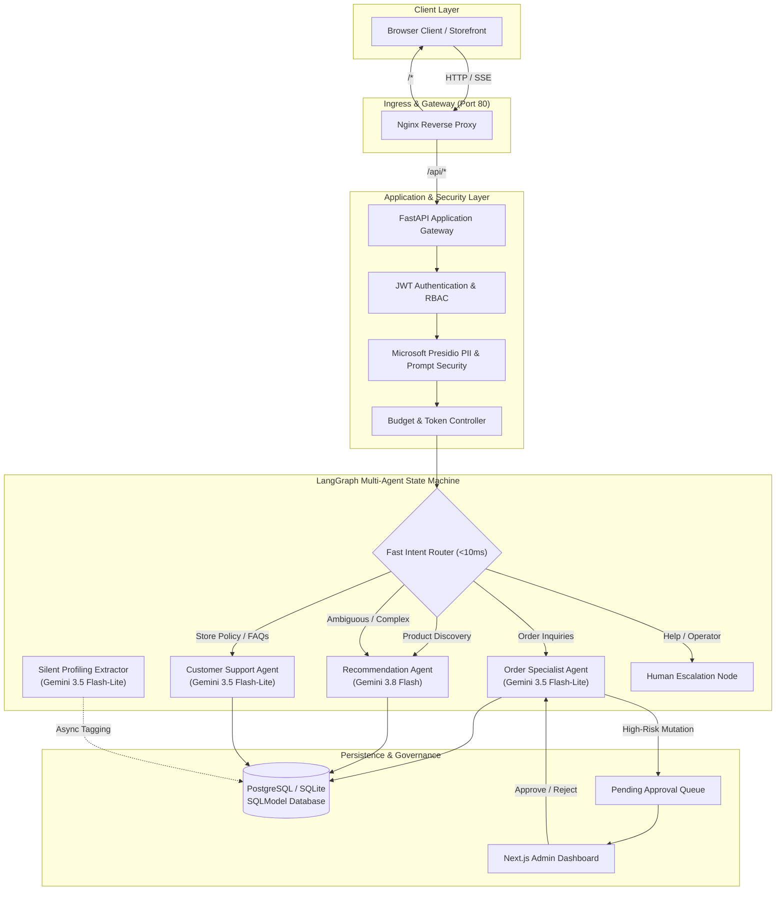

# 🛍️ Aisle: Production Multi-Agent E-Commerce Platform

<div align="center">

[](https://python.org)
[](https://fastapi.tiangolo.com)
[](https://langchain-ai.github.io/langgraph/)
[](https://ai.google.dev)
[](https://nextjs.org)
[](https://nginx.org)
[](https://docker.com)
[](https://docs.pytest.org)
[](https://opensource.org/licenses/MIT)

<p align="center">
  <b>A state-driven, enterprise-grade multi-agent autonomous storefront assistant and customer support engine.</b><br>
  Built with LangGraph state machines, Microsoft Presidio PII guardrails, Human-in-the-Loop manager approval workflows, and real-time SSE streaming.
</p>

[Key Features](#-core-architectural-highlights) • [Architecture](#-system-architecture) • [Agent Roster](#-multi-agent-system-roster) • [Live UI Experience](#-interactive-ui-walkthrough) • [Quick Start](#-quick-start-docker) • [API Docs](#-api-specification) • [LLMOps & Testing](#-evaluation--testing)

---

</div>

## 📌 Executive Overview

Traditional e-commerce platforms force users through fragmented friction points: complex category filtering, static order lookup tables, disconnected refund forms, and unresponsive ticketing queues.

**Aisle transforms static storefronts into proactive, autonomous retail assistants.** It unites discovery, cart management, order tracking, and customer service under a single unified conversational interface—engineered not as a fragile LLM wrapper, but as an **auditable, deterministic, state-driven multi-agent platform**.

```
Customer: "Can you suggest wireless headphones under $100 and check where order ORD-1001 is?"
┌────────────────────────────────────────────────────────────────────────┐
│ ⚡ Fast Router (<10ms) ➔ Parallel Decomposition                         │
│ ├── 🎧 Recommendation Agent: Scans SQLModel catalog for <$100 audio     │
│ ├── 📦 Order Agent: Retrieves tracking & shipping carrier for ORD-1001  │
│ └── 🛡️ Profiling Agent: Silently updates affinity: ["electronics"]     │
│ ↳ Combined natural response + interactive UI product & tracking cards  │
└────────────────────────────────────────────────────────────────────────┘
```

---

## 🌟 Core Architectural Highlights

Unlike toy chatbots that rely on unstructured system prompts and ephemeral dictionaries, Aisle is built with defense-in-depth enterprise software engineering principles:

### 1. ⚡ Sub-10ms Fast Intent Routing
* Implemented a zero-latency regex classifier that intercepts common transactional intents (order lookups, status queries, human handoff requests) in **under 10 milliseconds**.
* Gracefully delegates complex, ambiguous multi-step queries to **Gemini 3.8 Flash**, avoiding unnecessary LLM token latency and cost on routine calls.

### 2. 🛡️ Enterprise Data Privacy & PII Scrubbing
* Every incoming prompt is sanitized through **Microsoft Presidio Analyzer & Anonymizer** before reaching any external LLM endpoint.
* Entities including **Email addresses, US/International phone numbers, Credit Card numbers, Social Security Numbers (SSN), and IP addresses** are automatically detected and replaced with typed surrogate tokens (e.g., `[EMAIL_ADDRESS_REDACTED]`).
* Integrated prompt-injection and jailbreak defense layers prevent adversarial prompt-leakage attacks.

### 3. 🚦 Human-in-the-Loop (HITL) Manager Approvals
* High-risk operations (e.g., order cancellations, address changes, custom refunds) **automatically pause agent execution**.
* Pushes an actionable transaction task to a persistent SQLModel `PendingApproval` queue.
* Managers review and approve or reject tasks from the Next.js Admin Dashboard, after which graph execution resumes with transactional rollback protection.

### 4. 📊 Real-Time Server-Sent Events (SSE) & Latency Telemetry
* Streams LangGraph state node transitions to the frontend in real time via an `/api/chat/stream` SSE channel.
* The Next.js pipeline visualizer computes node execution duration in real time, rendering live status badges (`fast_intent (4ms)`, `order_agent (420ms)`) to provide complete transparency into multi-agent thought processes.

### 5. 💰 Multi-Tier Budget Guardrails & Graceful Degradation
* Tracks real-time token consumption across sessions and global daily quotas.
* Enforces hard spending caps (\$10/day, \$2/session) with proactive warnings at 80% usage.
* Supports **graceful model degradation**: dynamically swaps heavy reasoning agents down to ultra-low-cost models (`gemini-3.5-flash-lite` or `openai/gpt-oss-20b`) before falling back to static search or human escalation.

### 6. 🌐 Unified Ingress via Nginx Gateway (Port 80)
* Single reverse proxy handles all client traffic under port `80`.
* Eliminates CORS headers, protects backend FastAPI endpoints from direct public exposure, and provides specialized `proxy_buffering off;` handling for uninterrupted SSE streaming.

---

## 🏗️ System Architecture



---

## 🤖 Multi-Agent System Roster

Aisle allocates specialized models based on task complexity, balancing high reasoning power against low cost and sub-second latency:

| Agent Role | Active Gemini Model | Active Groq Fallback | Responsibility | Cost / 1K Tokens |
| :--- | :--- | :--- | :--- | :--- |
| **Supervisor Router** | `gemini-3.8-flash` | `openai/gpt-oss-120b` | Intent classification, query decomposition, agent delegation | \$0.00075 / \$0.00375 |
| **Recommendation Specialist** | `gemini-3.8-flash` | `openai/gpt-oss-120b` | Catalog search, customer interest matching, cross-selling | \$0.00075 / \$0.00375 |
| **Order Specialist** | `gemini-3.5-flash-lite` | `openai/gpt-oss-20b` | Structured tool execution, shipment tracking, cancellation requests | \$0.00030 / \$0.00250 |
| **Customer Support Agent** | `gemini-3.5-flash-lite` | `openai/gpt-oss-20b` | Store policy queries, return terms, FAQs | \$0.00030 / \$0.00250 |
| **Silent Profiling Extractor** | `gemini-3.5-flash-lite` | `openai/gpt-oss-20b` | Background JSON preference extraction from user turns | \$0.00030 / \$0.00250 |
| **Degraded Fallback Mode** | `gemini-3.5-flash-lite` | `openai/gpt-oss-20b` | High-speed, minimal-cost fallback when approaching budget limits | \$0.00030 / \$0.00250 |

> [!NOTE]
> The dynamic model factory ([llm_factory.py](file:///f:/Portfolio%20projects/Aisle(langgraph%20agent)/app/agents/llm_factory.py)) routes to **ChatGoogleGenerativeAI** when Gemini is configured, and automatically switches to **ChatGroq** when non-Gemini models are selected in `.env`.

---

## 💻 Interactive UI Walkthrough

Aisle features a modular, reactive UI built with **Next.js 14**, **Tailwind CSS**, and **Radix UI**:

* **Conversational Storefront ([chat-interface.tsx](file:///f:/Portfolio%20projects/Aisle(langgraph%20agent)/frontend/src/components/chat/chat-interface.tsx)):** Supports multi-turn dialogues, Markdown formatting, real-time typing indicators, and embedded interactive product and order cards.
* **Live Agent Pipeline Visualizer ([pipeline-visualizer.tsx](file:///f:/Portfolio%20projects/Aisle(langgraph%20agent)/frontend/src/components/pipeline/pipeline-visualizer.tsx)):** Real-time animated diagram showing which agent nodes are active, tools invoked, and execution latencies in milliseconds.
* **Human-in-the-Loop Admin Queue ([approval-queue.tsx](file:///f:/Portfolio%20projects/Aisle(langgraph%20agent)/frontend/src/components/admin/approval-queue.tsx)):** Manager interface to view pending customer cancellation requests, inspect full conversation context, and approve or decline with a single click.
* **LLMOps Budget Dashboard ([budget-gauge.tsx](file:///f:/Portfolio%20projects/Aisle(langgraph%20agent)/frontend/src/components/dashboard/budget-gauge.tsx)):** Live visualization of session token usage, cumulative daily API spend, and remaining quota.

---

## ⚖️ Architectural Design Decisions: Demo vs. Production

When evaluating this platform, it is important to understand the design rationale between sandbox protections and production enterprise architecture:

### 1. Hard Budget Cutoffs
* **In this Demo:** If a user session exceeds `$2.00` in token consumption or submits excessive requests, the system halts execution and escalates to human handoff. This safeguards personal API keys from denial-of-wallet attacks.
* **In Live Production:** A hard block creates friction and drives cart abandonment. An enterprise deployment replaces hard stops with **cart-value proportional budgets** (e.g., higher allowances for \$500+ shopping carts), customer tier-based limits (VIP vs. Anonymous), and **automatic graceful model degradation**.

### 2. State Checkpointing
* **In this Demo:** Employs an in-memory `MemorySaver` checkpointer for fast local testing and minimal dependency overhead.
* **In Live Production:** Checkpointing seamlessly upgrades to `AsyncPostgresSaver` backed by PostgreSQL (`DATABASE_URL=postgresql+psycopg://...`), ensuring zero state loss across server restarts and distributed horizontal scaling.

---

## 🚀 Quick Start (Docker)

Launch the entire stack—Nginx Gateway, PostgreSQL, FastAPI Backend, and Next.js Frontend—with a single command:

### 1. Clone & Configure
```bash
git clone https://github.com/Saumojit30/Aisle.git
cd Aisle

# Copy environment template
cp .env.example .env
```

### 2. Add API Keys in `.env`
```env
# Required: Gemini API Key (from https://aistudio.google.com)
GEMINI_API_KEY=your_gemini_api_key_here

# Optional: Groq API Key (for alternative fallback)
GROQ_API_KEY=your_groq_api_key_here
```

### 3. Spin Up Container Stack
```bash
docker compose up --build
```

### 4. Access the Application
* **Storefront & Admin Dashboard:** [http://localhost](http://localhost) *(Served via Nginx Port 80)*
* **Interactive API Documentation:** [http://localhost/docs](http://localhost/docs)
* **OpenAPI Schema:** [http://localhost/openapi.json](http://localhost/openapi.json)

---

## 🛠️ Local Development (Without Docker)

### Backend Setup (FastAPI & LangGraph)
```bash
# 1. Create and activate virtual environment
python -m venv .venv
# Windows: .venv\Scripts\activate | macOS/Linux: source .venv/bin/activate

# 2. Install dependencies
pip install -e ".[dev]"

# 3. Initialize database with seed data
python -m app.db.seed

# 4. Start backend server
uvicorn app.main:app --reload --port 8080
```

### Frontend Setup (Next.js 14)
```bash
cd frontend
npm install
npm run dev
# Accessible at http://localhost:3000
```

---

## 📖 API Specification

| Method | Endpoint | Description | Auth Level |
| :--- | :--- | :--- | :--- |
| `POST` | `/auth/register` | Register new customer account & receive JWT token | Public |
| `POST` | `/auth/login` | OAuth2 password login & receive JWT token | Public |
| `GET` | `/auth/me` | Retrieve authenticated user profile | Bearer Token |
| `POST` | `/chat` | Standard request/response chat interaction | Optional |
| `GET` | `/chat/stream` | Server-Sent Events (SSE) stream with per-node latencies | Optional |
| `GET` | `/admin/approvals` | List pending Human-in-the-Loop manager approval tasks | Admin |
| `POST` | `/admin/approvals/{id}/respond` | Approve or reject a high-risk agent action | Admin |
| `GET` | `/products` | Filter product catalog with pricing and stock data | Public |
| `GET` | `/orders` | Retrieve authenticated user's order history | Bearer Token |

---

## 🔬 Evaluation & Testing

Aisle includes an automated evaluation and testing suite covering unit behavior, database persistence, and LLMOps benchmarks:

```bash
.venv\Scripts\python.exe -m pytest tests/ -v
```

### Test Suite Highlights (33/33 Passing):
* **Supervisor Intent Accuracy (`test_eval_suite.py`):** Verified 100% correct routing across transactional and conversational test cases.
* **Presidio PII Anonymization (`test_v2_enterprise.py`):** Tests accurate masking of emails, phone numbers, and SSNs.
* **Security & Prompt Injection (`test_v2_enterprise.py`):** Asserts adversarial injection payloads are neutralized before entering the graph.
* **Token Budget Controller (`test_graph.py`):** Verifies cost estimation, daily limit rollover, and session rate limits.
* **Dynamic Model Degradation (`test_model_degradation.py`):** Verifies state machine correctly shifts to low-cost fallback models at 80% budget capacity.
* **Database & Auth Lifecycle (`test_memory_persistence.py`):** Verifies SQLModel CRUD operations, password hashing, and JWT expiration.

---

## 📂 Project Directory Structure

```
Aisle/
├── app/
│   ├── agents/               # Specialist agent definitions & LLM factory
│   │   ├── llm_factory.py    # Dynamic Gemini / Groq provider switch
│   │   ├── supervisor.py     # Fast sub-10ms intent router & LLM fallback
│   │   ├── order_agent.py    # Order status, shipment, and cancellation tools
│   │   ├── rec_agent.py      # Product search & recommendation synthesis
│   │   ├── support_agent.py  # Return policy and FAQ assistant
│   │   └── profiling_agent.py# Background customer interest extractor
│   ├── graph/                # LangGraph StateGraph workflow definition
│   │   └── graph.py          # State machine, conditional edges & checkpointers
│   ├── db/                   # SQLModel models, database connection, and seeding
│   ├── security/             # Presidio PII sanitizer, JWT auth, and budget controller
│   ├── api.py                # FastAPI routes & SSE streaming endpoints
│   ├── config.py             # Pydantic Settings & Docker secrets loader
│   └── main.py               # Application entry point
├── frontend/
│   ├── src/
│   │   ├── app/              # Next.js 14 App Router pages
│   │   ├── components/       # Storefront, pipeline visualizer, and admin queue
│   │   └── lib/              # API client and authentication hooks
│   └── Dockerfile            # Multi-stage Next.js production build
├── deploy/                   # Cloud Run and container deployment manifests
├── tests/                    # Pytest test suite & LangSmith eval runner
├── docker-compose.yml        # Multi-container orchestration (Nginx, App, DB)
├── nginx.conf                # Unified reverse proxy configuration
└── README.md
```

---

## 📄 License

This project is licensed under the [MIT License](LICENSE).
